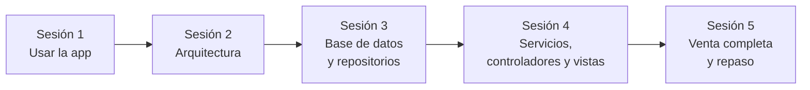

# 1. Plan de estudio

El plan está pensado en **5 sesiones de 1 a 2 horas**. No hace falta memorizar el código:
la idea es entender **qué hace cada capa y cómo viaja un dato** desde la pantalla hasta la
base de datos y de vuelta.

---

## Sesión 1 — Conocer la aplicación como usuario

**Objetivo:** saber qué hace el sistema antes de mirar el código.

- [ ] Ejecutar el proyecto (ver `07_Ejecutar_y_errores_comunes.md`).
- [ ] Entrar con los 3 perfiles (Isaac, Jeremy, Bernabe) y anotar qué menús ve cada uno.
- [ ] Registrar un cliente nuevo y fijarse en el código que le asigna (`CLI-006`).
- [ ] Probar una validación: poner un DNI de 5 dígitos y ver el mensaje en rojo.
- [ ] Hacer una venta de 1 celular + 1 accesorio y revisar el historial.
- [ ] Volver a *Inventario* y comprobar que el stock bajó.
- [ ] Cambiar a estilo oscuro e idioma inglés desde el menú.

**Leer:** `02_Vision_general.md`.

## Sesión 2 — La arquitectura en capas

**Objetivo:** entender por qué hay tantos paquetes y qué hace cada uno.

- [ ] Leer `03_Arquitectura.md`.
- [ ] Abrir `config/AppContext.java` y ubicar las 3 capas que registra.
- [ ] Abrir `CelMax.java` y `App.java`: ¿cuál es el `main` y cuál carga el login?
- [ ] Abrir `module-info.java` y explicar `requires` y `opens` con tus palabras.
- [ ] Dibujar en papel el diagrama de capas sin mirar.

## Sesión 3 — Base de datos y repositorios (JDBC)

**Objetivo:** entender cómo se guardan y leen los datos.

- [ ] Leer `04_Base_de_datos.md` y abrir `db/trabajo_celmax.architect` en SQL Power Architect.
- [ ] Leer `schema_celmax.sql` y `data_celmax.sql`.
- [ ] Leer `DatabaseConfig.java`: ¿cuándo se crean las tablas? ¿cuándo se cargan los datos?
- [ ] Leer `SqlHelper.java` → `AbstractJpaRepository.java` → `ClienteRepository.java` (en ese orden).
- [ ] Explicar qué hace `mapRow()` y qué hace `nextCode()`.

## Sesión 4 — Servicios, controladores y vistas

**Objetivo:** seguir el camino del botón **Guardar**.

- [ ] Leer `ICrudGenericoService` y `CrudGenericoServiceImp`.
- [ ] Leer `ClienteController.java` junto con `view/main_cliente.fxml` (fíjate en `fx:id` y `onAction`).
- [ ] Leer `components/FormHelper.java` y `TableViewHelper.java`.
- [ ] Leer la sección "Guardar un cliente" de `05_Recorrido_del_codigo.md`.
- [ ] Ver en el modelo `Cliente.java` las anotaciones `@Pattern`, `@Email`, `@NotBlank`.

## Sesión 5 — La venta completa y repaso final

**Objetivo:** entender la parte más importante del negocio.

- [ ] Leer la sección "Registrar una venta" de `05_Recorrido_del_codigo.md`.
- [ ] Leer `VentaController` → `VentaServiceImp` → `VentaRepository.insert()`.
- [ ] Explicar qué es una **transacción** y qué pasa si no hay stock (rollback).
- [ ] Calcular a mano el IGV de una venta de S/ 1424 y compararlo con el sistema.
- [ ] Leer `06_Conceptos_POO.md`.
- [ ] Responder `08_Preguntas_y_ejercicios.md` sin mirar las respuestas.

---

## Reparto sugerido para la exposición

| Integrante | Tema | Archivos clave |
|------------|------|----------------|
| 1 | Demo de la app y perfiles | Pantallas, `MenuMenuItemDaoImp` |
| 2 | Arquitectura e inyección de dependencias | `AppContext`, `module-info`, `pom.xml` |
| 3 | Base de datos y repositorios | `schema_celmax.sql`, `SqlHelper`, `AbstractJpaRepository` |
| 4 | CRUD, validaciones y vistas | `ClienteController`, `FormHelper`, FXML, CSS |
| 5 | Proceso de venta y transacción | `VentaController`, `VentaServiceImp`, `VentaRepository` |

## Cómo estudiar el código (método)

1. **De afuera hacia adentro:** primero la pantalla, luego el controlador, luego el servicio,
   luego el repositorio y al final el SQL.
2. **Sigue un solo dato:** por ejemplo el DNI de un cliente. ¿En qué `TextField` entra? ¿En qué
   atributo del modelo se guarda? ¿En qué columna termina?
3. **Usa el depurador:** pon un *breakpoint* en `ClienteController.validarFormulario()` y avanza
   con F8/F10 para ver cada paso.
4. **Cambia algo pequeño y observa:** cambia un mensaje de validación o un color del CSS y vuelve
   a ejecutar.
5. **Explícalo en voz alta:** si puedes explicar un archivo a un compañero en 1 minuto, lo entendiste.
