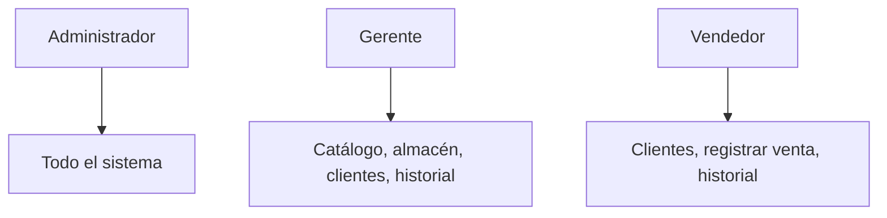

# 2. Visión general — ¿Qué es CelMax?

**CelMax** es una tienda (ficticia) que vende **celulares de última generación** y
**accesorios** (fundas, micas, cargadores, audífonos…) en varias **sucursales** del Perú.

La aplicación es un **sistema de escritorio** para que los trabajadores:

- registren clientes, celulares, accesorios y sucursales;
- controlen el **inventario** (stock y precio de cada celular en cada tienda);
- registren **ventas** con cálculo automático de **IGV (18 %)**;
- consulten el **historial** de ventas y su detalle.

## Tecnologías

| Tecnología | Para qué |
|------------|----------|
| **Java 21** | Lenguaje |
| **JavaFX 21 + FXML + CSS** | Interfaz gráfica de escritorio |
| **Maven** | Descargar librerías, compilar y ejecutar (`pom.xml`) |
| **H2** | Base de datos que vive en un archivo (`data/celmax.mv.db`), no hay que instalar nada |
| **HikariCP** | Pool de conexiones a la base de datos |
| **JDBC** | Ejecutar SQL desde Java (sin Hibernate/JPA) |
| **Lombok** | Genera getters, setters, constructores y *builders* |
| **Jakarta Validation** | Validar formularios con anotaciones (`@NotBlank`, `@Email`…) |

La estructura es **la misma del proyecto SysVentas** trabajado en clase
(repositorio `POO2026-2-G3`, rama `dev-Sesion11`).

## Perfiles y qué puede hacer cada uno

| Menú → opción | Administrador | Gerente | Vendedor |
|---------------|:---:|:---:|:---:|
| Principal → Inicio / Cerrar sesión | ✔ | ✔ | ✔ |
| Catálogo → Celulares, Accesorios | ✔ | ✔ | |
| Almacén → Sucursales, Inventario | ✔ | ✔ | |
| Ventas → Clientes, Historial | ✔ | ✔ | ✔ |
| Ventas → Registrar venta | ✔ | | ✔ |
| Administración → Usuarios | ✔ | | |

## Pantallas

| Pantalla | Qué se hace | Archivo FXML | Controlador |
|----------|-------------|--------------|-------------|
| Login | Ingresar con usuario y contraseña | `login.fxml` | `LoginController` |
| Principal | Cabecera, menú por perfil y pestañas | `maingui.fxml` | `MainguiController` |
| Inicio | Tarjetas de resumen, últimas ventas, stock bajo | `main_inicio.fxml` | `InicioController` |
| Clientes | CRUD de clientes | `main_cliente.fxml` | `ClienteController` |
| Celulares | CRUD de modelos de celular | `main_celular.fxml` | `CelularController` |
| Accesorios | CRUD de accesorios (stock bajo en rojo) | `main_accesorio.fxml` | `AccesorioController` |
| Sucursales | CRUD de tiendas | `main_sucursal.fxml` | `SucursalController` |
| Inventario | Stock y precio de cada celular por sucursal | `main_inventario.fxml` | `InventarioController` |
| Usuarios | CRUD de usuarios y su perfil | `main_usuario.fxml` | `UsuarioController` |
| Registrar venta | Carrito, totales e IGV | `main_venta.fxml` | `VentaController` |
| Historial | Ventas y su detalle | `main_historial.fxml` | `HistorialVentaController` |

> **CRUD** = *Create, Read, Update, Delete* (registrar, listar, editar, eliminar).

## Idea clave del negocio

- Un **celular** no tiene precio propio: su precio y stock dependen de la **sucursal**
  (tabla `Inventario`). El mismo iPhone puede costar distinto en Lima y en Cusco.
- Un **accesorio** sí tiene su propio precio y stock.
- Cada línea de una venta (`DetalleVenta`) es **un celular o un accesorio**, nunca los dos.
- Los precios **ya incluyen IGV**; el sistema separa el neto y el IGV al final.
