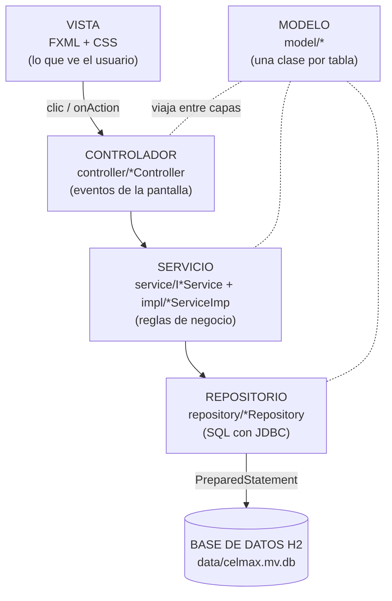
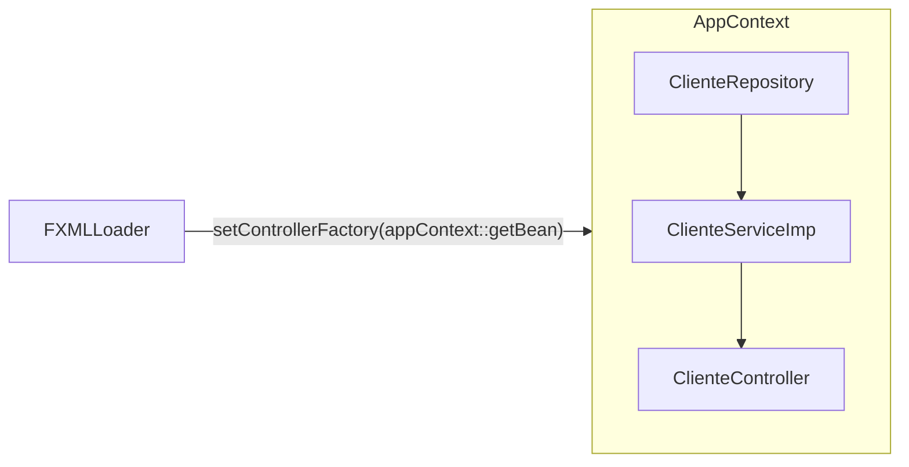
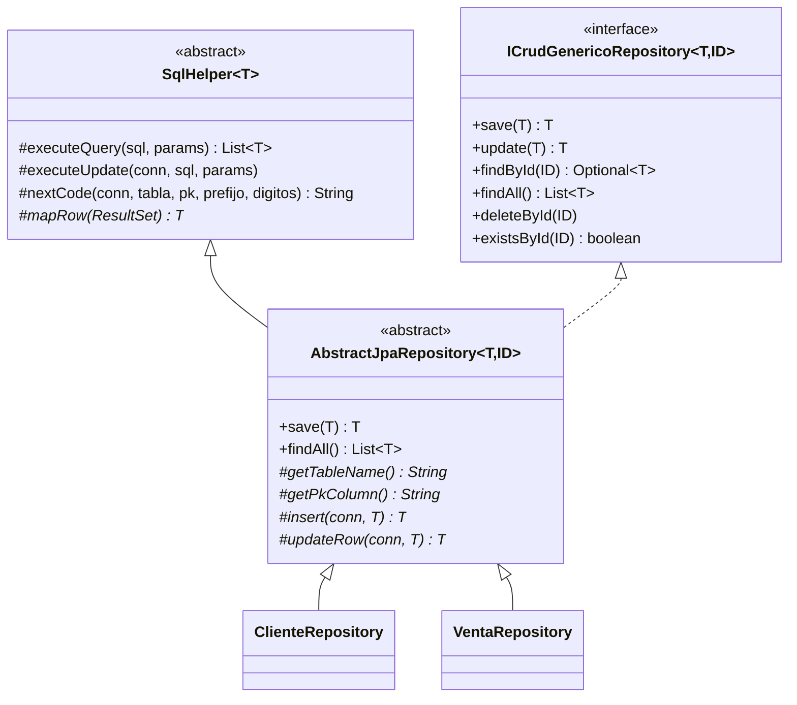
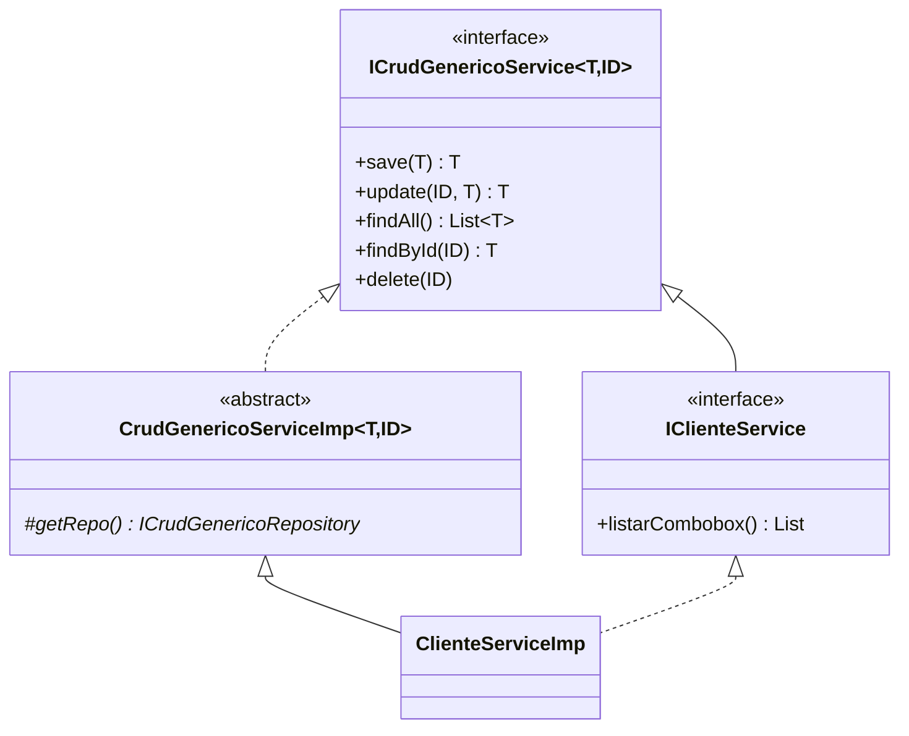

# 3. Arquitectura — capas, paquetes y patrones

## 3.1 Arquitectura en capas

Cada capa **solo conoce a la capa de abajo**. Así, si mañana cambiamos H2 por PostgreSQL,
solo se toca la capa de datos.



Versión en texto (por si el diagrama no se dibuja):

```
 Pantalla (FXML) ──► Controller ──► Service ──► Repository ──► H2
        ▲                                                       │
        └──────────── objetos del Model (Cliente, Venta…) ◄─────┘
```

| Capa | Responsabilidad | Ejemplo |
|------|-----------------|---------|
| **Vista** | Mostrar datos y recibir clics | `main_cliente.fxml` |
| **Controlador** | Leer los campos, validar, llamar al servicio, refrescar la tabla | `ClienteController` |
| **Servicio** | Reglas del negocio (IGV, stock, “no existe el ID”) | `VentaServiceImp.calcularTotales()` |
| **Repositorio** | Traducir objetos ⇄ filas SQL | `ClienteRepository.insert()` |
| **Modelo** | Representar una tabla como clase Java | `Cliente` |

## 3.2 Paquetes del proyecto

```
pe.edu.upeu.celmax
├── App / CelMax        arranque (main → Application JavaFX → login)
├── config              AppContext (inyección de dependencias), DatabaseConfig (H2 + Hikari)
├── model               Categoria, Perfil, Usuario, Cliente, Celular, Accesorio,
│                       Sucursal, Inventario, Venta, DetalleVenta
├── repository          ICrudGenericoRepository, AbstractJpaRepository, *Repository
│   └── helper          SqlHelper (JDBC puro)
├── service             I*Service (interfaces), ICrudGenericoService
│   └── impl            *ServiceImp, CrudGenericoServiceImp, MenuMenuItemDaoImp
├── controller          un controlador por pantalla
├── components          TableViewHelper, FormHelper, Toast, ToltipCustom, ColumnInfo, StageManager
├── dto                 ComboBoxOption, ProductoVenta, SessionManager, MenuMenuItenTO
├── enums               TipoProducto (CELULAR / ACCESORIO)
├── exception           ModelNotFoundException
└── utils               UtilsX (lee los archivos de idioma)
```

Recursos (`src/main/resources`): `view/*.fxml`, `css/*.css`, `img/`, `application.properties`,
`schema_celmax.sql`, `data_celmax.sql`.

## 3.3 Inyección de dependencias manual (`AppContext`)

En lugar de usar Spring, el proyecto arma todos los objetos **una sola vez** en `AppContext`
y los guarda en un `Map<Class, Object>`.



1. `registrarRepositorios()` crea los repositorios.
2. `registrarServicios()` crea cada servicio **pasándole su repositorio por el constructor**.
3. `registrarControladores()` crea cada controlador **pasándole sus servicios**.
4. Cuando JavaFX carga un `.fxml`, el `FXMLLoader` pide el controlador a `AppContext.getBean()`.

Por eso los controladores tienen `@RequiredArgsConstructor` (Lombok crea el constructor con los
atributos `final`).

## 3.4 Jerarquía genérica (lo más importante para entender el código)



- `SqlHelper` sabe **ejecutar SQL** (abre conexión, pone parámetros `?`, recorre el `ResultSet`).
- `AbstractJpaRepository` implementa el CRUD **una sola vez** para todas las tablas.
- Cada repositorio concreto solo dice: nombre de la tabla, nombre de la PK, cómo insertar,
  cómo actualizar y cómo convertir una fila en objeto (`mapRow`).

Lo mismo pasa en servicios:



## 3.5 Patrones de diseño usados

| Patrón | Dónde | Idea |
|--------|-------|------|
| **Singleton** | `AppContext`, `SessionManager`, `DatabaseConfig` | Una sola instancia para toda la app |
| **Template Method** | `AbstractJpaRepository.save()` llama a `insert()` | El algoritmo general está en la clase padre; los pasos los define el hijo |
| **Repository** | `*Repository` | Esconde el SQL detrás de métodos como `findAll()` |
| **Inyección de dependencias** | `AppContext` + constructores | Los objetos reciben lo que necesitan, no lo crean |
| **MVC** | FXML (vista) + Controller + Model | Separar pantalla, lógica y datos |
| **Builder** | `Cliente.builder().dni(..).build()` (Lombok) | Crear objetos legibles con muchos atributos |
| **DTO** | `ProductoVenta`, `ComboBoxOption` | Objetos solo para transportar datos a la pantalla |

## 3.6 `module-info.java` en una línea cada uno

- `requires javafx.controls / javafx.fxml` → usamos JavaFX.
- `requires java.sql, com.zaxxer.hikari, com.h2database` → base de datos.
- `requires jakarta.validation` → validaciones; `requires static lombok` → solo al compilar.
- `opens ...controller to javafx.fxml` → el FXMLLoader puede inyectar los `@FXML`.
- `opens ...model` y `opens ...dto` → las tablas (`TableView`) pueden leer los getters por reflexión.
