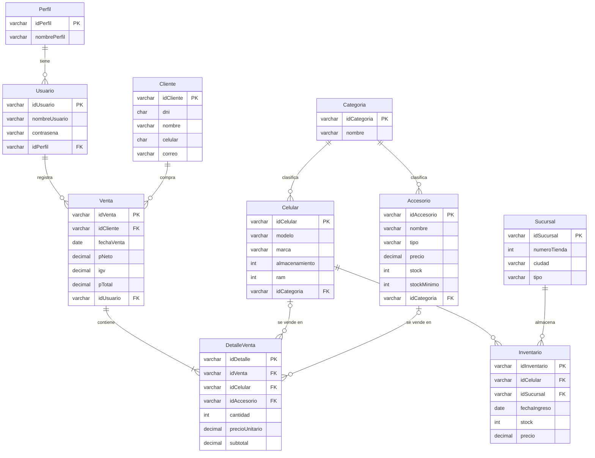
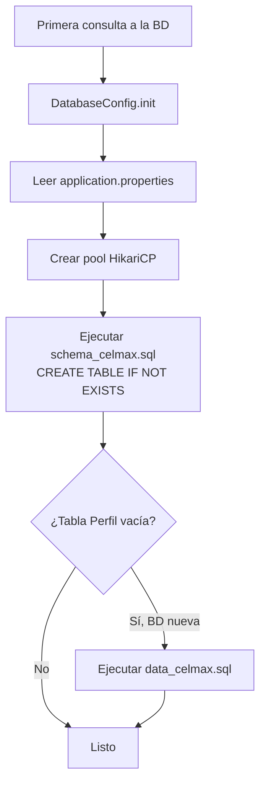

# 4. Base de datos

- **Motor:** H2 en archivo → `Proyecto/CelMax/data/celmax.mv.db` (se crea solo).
- **Modelo:** `Proyecto/db/trabajo_celmax.architect` (se abre con SQL Power Architect).
- **Scripts:** `schema_celmax.sql` (tablas) y `data_celmax.sql` (datos del Excel).
- **Diccionario completo:** `Proyecto/db/BASE_DATOS.md`.

## 4.1 Diagrama entidad–relación



## 4.2 Las 10 tablas en una frase

| Tabla | Qué guarda | Ejemplo |
|-------|-----------|---------|
| Categoria | Celulares o Accesorios | `CAT-01` Celulares |
| Perfil | Rol del usuario | `PF-03` Vendedor |
| Usuario | Trabajadores que entran al sistema | `USR-03` Bernabe |
| Cliente | Personas que compran | `CLI-001` Rosa Villanueva |
| Celular | Modelos de celular (sin precio) | `CEL-001` iPhone 17 Pro |
| Accesorio | Accesorios con precio y stock | `ACC-002` Mica de vidrio |
| Sucursal | Tiendas | `SUC-01` Lima, Flagship |
| Inventario | Stock y precio de un celular en una sucursal | `INV-001` iPhone en Lima, 12 und, S/ 5499 |
| Venta | Cabecera: cliente, vendedor, fecha, totales | `VTA-001` S/ 1424.00 |
| DetalleVenta | Cada producto vendido en una venta | `DET-001` 1 Honor 400 |

## 4.3 Claves y relaciones

- **PK (clave primaria):** identifica una fila. Aquí son **códigos de texto** (`CEL-001`), igual
  que en el Excel. El método `SqlHelper.nextCode()` busca el mayor código y genera el siguiente.
- **FK (clave foránea):** apunta a la PK de otra tabla. Ej.: `Venta.idCliente → Cliente.idCliente`.
- **1 a muchos (1:N):** un cliente tiene muchas ventas; una venta tiene muchos detalles.
- **Tabla intermedia:** `Inventario` resuelve la relación **muchos a muchos** entre
  `Celular` y `Sucursal` (un celular está en varias tiendas y una tienda tiene varios celulares)
  y además guarda datos propios: stock, precio y fecha de ingreso.
- **Regla CHECK** en `DetalleVenta`: `idCelular` **o** `idAccesorio`, exactamente uno.

## 4.4 Reglas de negocio

1. **IGV:** los precios incluyen IGV.
   ```
   pTotal = suma de subtotales
   pNeto  = pTotal / 1.18
   igv    = pTotal - pNeto
   Ejemplo VTA-001: 1424.00 → neto 1206.78 + IGV 217.22
   ```
2. **Stock:** vender un celular descuenta de su fila de `Inventario`; vender un accesorio
   descuenta de `Accesorio.stock`. Si no alcanza, la venta **entera** se cancela.
3. **Stock bajo:** un accesorio con `stock <= stockMinimo` aparece en rojo y en la pantalla de inicio.
4. **Integridad:** no se puede borrar un celular que ya se vendió (la FK lo impide) y el sistema
   muestra un mensaje amigable.

## 4.5 Cómo se crea la base al arrancar



Para **reiniciar los datos** basta con cerrar la app y borrar la carpeta `Proyecto/CelMax/data/`.
