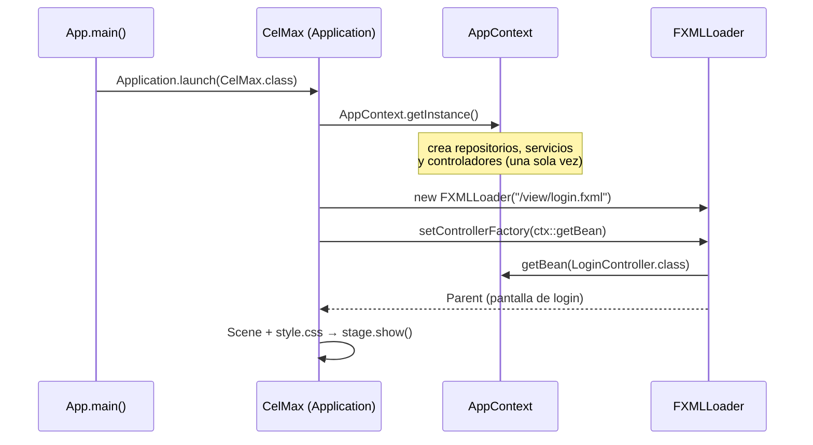
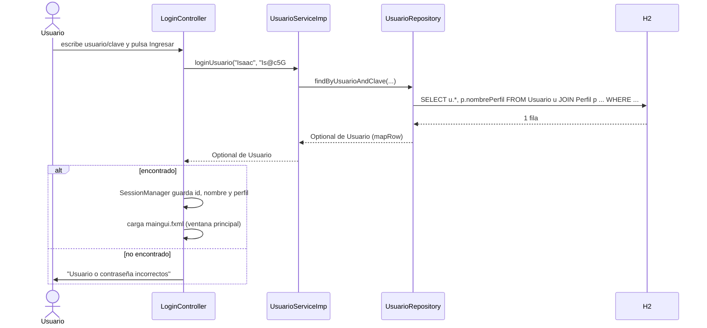
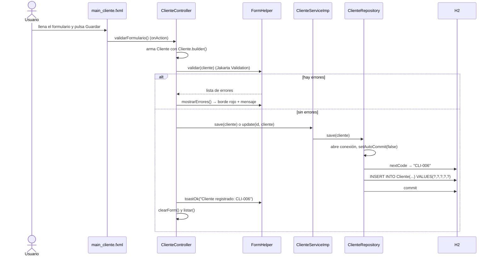
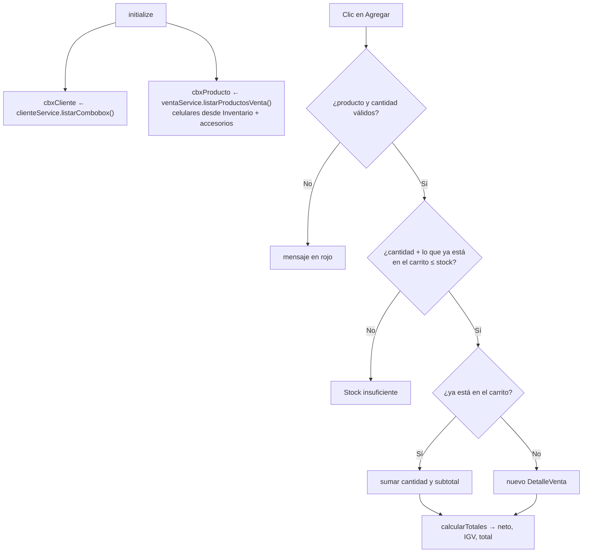
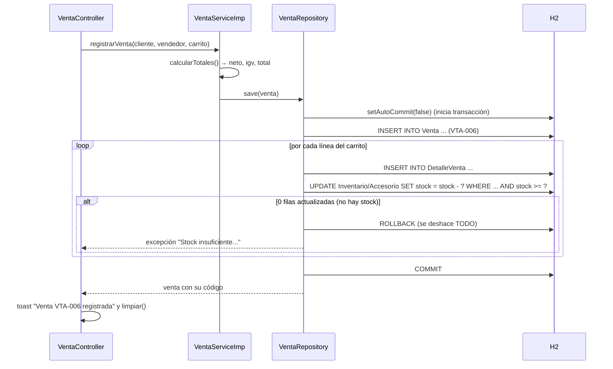

# 5. Recorrido del código — ¿qué pasa cuando…?

Aquí se sigue el camino de **cuatro acciones** reales, archivo por archivo.
Rutas relativas a `Proyecto/CelMax/src/main/java/pe/edu/upeu/celmax/`.

---

## 5.1 …se abre la aplicación



1. `App.main()` solo llama a `Application.launch(CelMax.class)`.
2. `CelMax.start()` obtiene el `AppContext`, carga `login.fxml`, le aplica `style.css` y muestra la ventana.
3. La base de datos **aún no se abre**: se abre en la primera consulta (el login).

---

## 5.2 …el usuario inicia sesión



Después, `MainguiController.initialize()`:

1. Muestra el usuario y su perfil en la cabecera.
2. Llama a `graficarMenus()`, que pide a `MenuMenuItemDaoImp.listaAccesos(perfil, idioma)`
   la lista de opciones permitidas y arma el `MenuBar` por código.
3. Abre la pestaña **Inicio**.

Al hacer clic en un menú, `MenuItemListener.handle()` mira el tipo:
`"T"` → abre el FXML en una **pestaña**; `"C"` → **cierra sesión** y vuelve al login.

---

## 5.3 …se guarda un cliente (CRUD típico)

Todos los CRUD (clientes, celulares, accesorios, sucursales, inventario, usuarios) funcionan **igual**.



Puntos a explicar en la exposición:

- `@FXML TextField txtDni` se conecta con `fx:id="txtDni"` del FXML.
- `onAction="#validarFormulario"` llama al método del mismo nombre.
- Las reglas (`@Pattern(regexp="\\d{8}")` para el DNI) están **en el modelo**, no en el controlador.
- **Editar:** el botón ✎ de la tabla llama a `editForm()`, que llena el formulario y guarda el
  id en `idClienteCE`; al guardar, si `idClienteCE != null` se hace `update` en vez de `save`.
- **Eliminar:** el botón ✖ pide confirmación; si la BD rechaza el borrado por una FK,
  `FormHelper.mensajeError()` lo traduce a un mensaje entendible.
- Los botones ✎ ✖ y las columnas los crea `TableViewHelper` a partir de un `LinkedHashMap`
  “título → atributo”.

---

## 5.4 …se registra una venta (lo más importante)

### Paso A: armar el carrito (solo en memoria)



- El carrito es una `ObservableList<DetalleVenta>`: la tabla se actualiza sola al agregar o quitar.
- `ProductoVenta` (paquete `dto`) es lo que se muestra en el combo: tipo, descripción,
  precio, stock e `idInventario` (para saber de qué sucursal sale el celular).

### Paso B: confirmar la venta (una transacción)



**¿Por qué una transacción?** Porque la venta son varias operaciones (cabecera, detalles y
stock). O se guardan **todas**, o **ninguna**. Si fallara a la mitad sin transacción, quedaría
una venta sin detalle o un stock descontado sin venta.

El truco está en `AbstractJpaRepository.save()`:

```java
conn.setAutoCommit(false);
try {
    T result = insert(conn, entity);   // VentaRepository.insert hace todo el trabajo
    conn.commit();
    return result;
} catch (Exception e) {
    conn.rollback();                   // si algo falla, se deshace todo
    throw e;
}
```

---

## 5.5 Mapa rápido: “quiero cambiar X, ¿dónde voy?”

| Quiero… | Archivo |
|---------|---------|
| Cambiar colores o tipografía | `resources/css/style.css` (y `estilo-oscuro.css`) |
| Mover un campo de una pantalla | `resources/view/main_*.fxml` |
| Cambiar un mensaje de validación | `model/<Entidad>.java` (anotaciones) |
| Cambiar qué menús ve un perfil | `service/impl/MenuMenuItemDaoImp.java` |
| Cambiar la tasa de IGV | `service/IVentaService.java` → `TASA_IGV` |
| Cambiar un SQL | `repository/<Entidad>Repository.java` |
| Agregar/quitar columnas de una tabla en pantalla | `controller/<Entidad>Controller.initialize()` |
| Cambiar los datos iniciales | `resources/data_celmax.sql` (y borrar la carpeta `data/`) |
| Cambiar los textos del menú | `language/idiomas-es.properties` / `idiomas-en.properties` |
